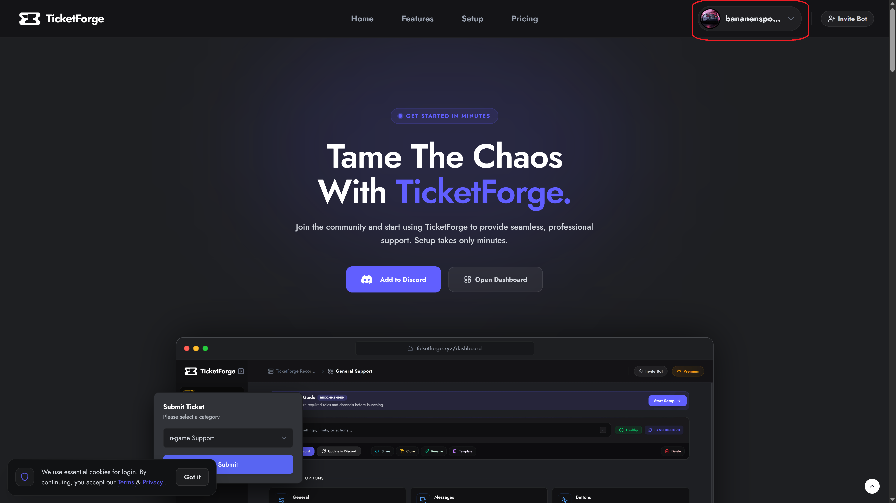
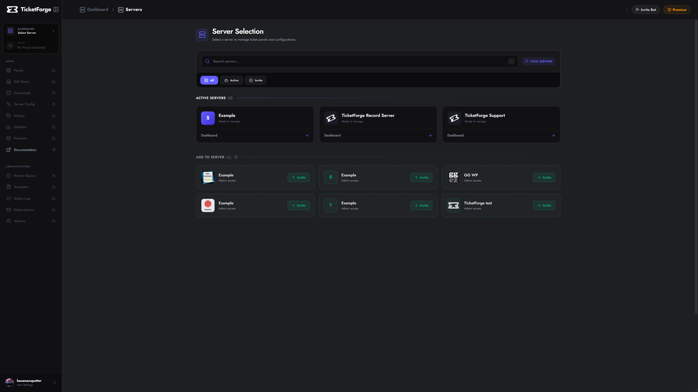
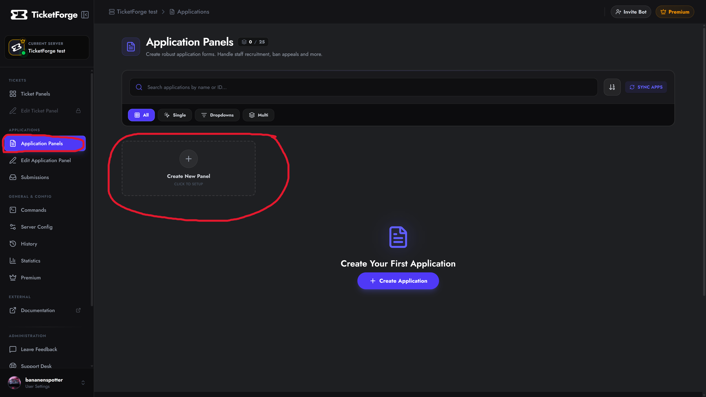
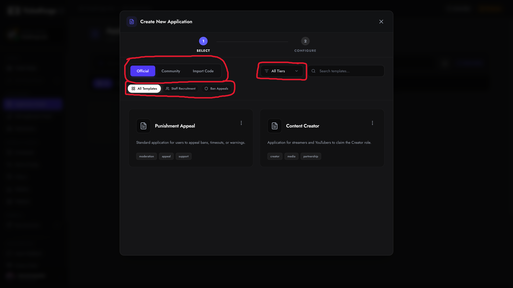
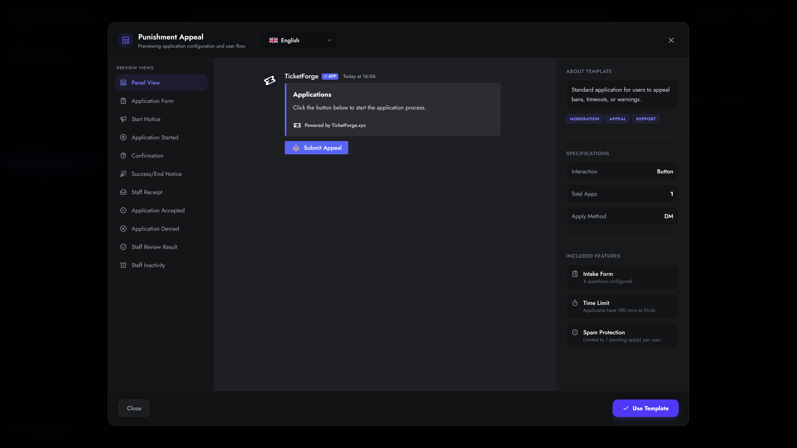
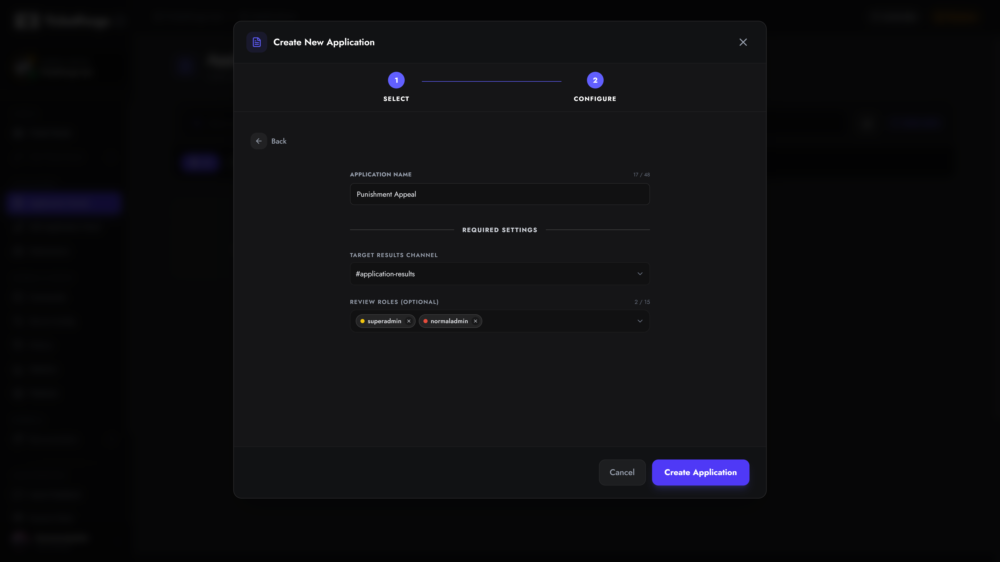
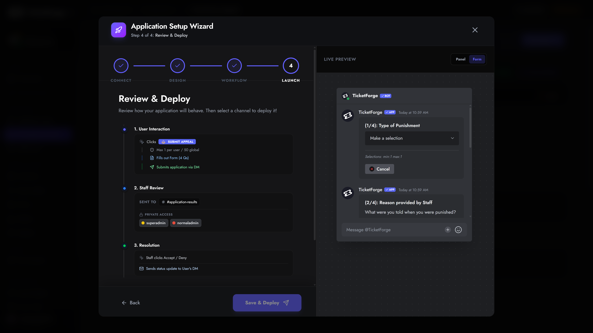

# Creating an Application

An **Application** allows you to collect structured data from your users through dynamic forms. TicketForge allows you to build multiple applications for different purposes (e.g., "Staff Recruitment", "Ban Appeals", "Giveaway Entry").

## 1. Login & Access

To begin, visit the [TicketForge Website](https://ticketforge.xyz).

1. Click the **Login with Discord** button in the top right corner.
2. Authorize the TicketForge application to access your account information.

<figure markdown>
  { loading=lazy }
  <figcaption>The main dashboard landing page.</figcaption>
</figure>

## 2. Server Selection

Once logged in, you will automatically navigate to the server selection page. Select the server where you want to create the application.

You can also navigate to this page by clicking on your profile and then "Servers".

1. Click on your **Profile Picture** in the top right corner to open the menu.
2. Select **Dashboard** from the dropdown menu.

<figure markdown>
  { loading=lazy }
  <figcaption>Your available servers list.</figcaption>
</figure>

!!! question "Can't see your server?"
    If a server is missing from this list, ensure you have the **Manage Server** permission on that Discord server. If you just got permissions, try logging out and logging back in to refresh your token.

## 3. Creating the Application

After selecting a server, navigate to the **Applications** tab in the sidebar and click the **Create Application** card.

<figure markdown>
  { loading=lazy }
  <figcaption>Click the card with the plus icon to begin.</figcaption>
</figure>

### Step A: Selection Strategy

You will be presented with three ways to start your configuration:

1.  **Official Templates (:material-check-decagram:)**: Pre-configured templates designed by our team for common use cases (e.g., "Staff Recruitment").
2.  **Community Templates (:material-account-group:)**: User-generated templates shared by other server owners. 
3.  **Import from Code (:material-code-json:)**: If you have a share code (format: `XXXX-XXXX-XXXX`), paste it here to clone an exact configuration.

<figure markdown>
  { loading=lazy }
  <figcaption>Select a template, browse by category, or import a code to proceed.</figcaption>
</figure>

#### Previewing Templates
Before making a choice, you can click on any template card to open a detailed **Interactive Preview**. This allows you to view the exact questions, the Discord embed message, and the user flow before committing to it.

<figure markdown>
  { loading=lazy }
  <figcaption>Preview the questions and visual layout before selecting a template.</figcaption>
</figure>

### Step B: Configuration

Once you click **Use Template**, you must configure the core identity of the application.

You only need to define three essential settings:
*   **Application Name:** The title of the form (e.g., "Moderator Application").
*   **Target Results Channel:** The private Discord channel where completed application answers will be posted for your staff to read. *(Required)*
*   **Review Roles (Optional):** The Discord roles (e.g., `@Head Mod`) that are allowed to click the "Accept" or "Deny" buttons on the submitted applications.

<figure markdown>
  { loading=lazy }
  <figcaption>The setup wizard ensures your application routes to the right channel.</figcaption>
</figure>

### Step C: Creation

Click **Create Application**. You will be instantly redirected to the **Application Editor** where you can finalize your questions, adjust automation rules, and send the form to your Discord server!

<figure markdown>
  { loading=lazy }
  <figcaption>Your application is created and ready for final edits.</figcaption>
</figure>