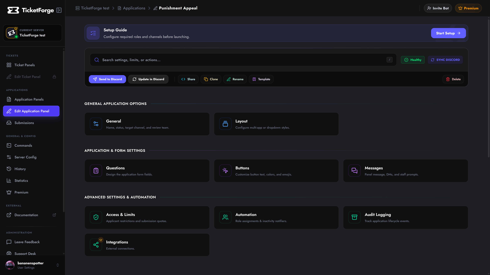
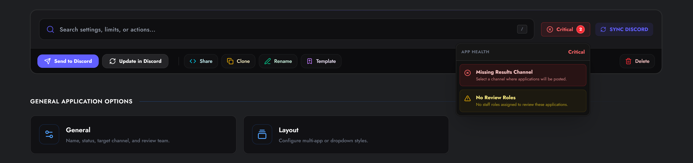
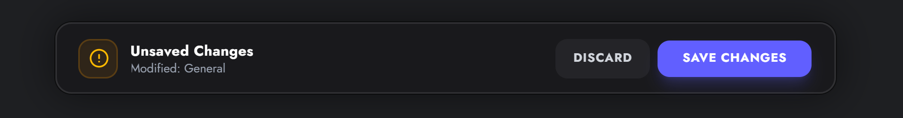
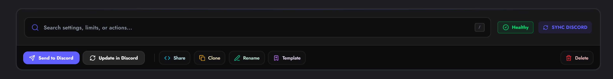

# The Application Editor

The **Application Editor** is your workspace for building and refining your forms. It features a real-time health check system, auto-save protection, and granular control over every aspect of your application workflow.

<figure markdown>
  { loading=lazy }
  <figcaption>The Application Editor view with the settings grid and action toolbar.</figcaption>
</figure>

## Editor Navigation

The application settings are divided into logical categories to help you build your form step-by-step:

### 1. General & Visuals
*   **General** — Rename the app, toggle its Active status, update the Target Results Channel, and select the Apply Method (DM, Web Portal, or Both).
*   **Layout** — Switch between standard buttons, dropdown menus, or multi-app layouts.
*   **Questions** — The core Form Builder. Add, edit, reorder, or set time limits on your questions.
*   **Buttons** — Customize the color, label, and emoji of the button users click to start the app.
*   **Messages** — Customize the text and embeds sent by the bot (Start Notice, Success Message, DM results, etc.).

### 2. Advanced & Automation
Powerful tools to restrict access and automate your workflow.

*   **Access & Limits** — Restrict applications to specific roles, set cooldowns, and cap pending applications.
*   **Automation** — Auto-assign roles when an application is submitted, accepted, or denied.
*   **Audit Logging** — Post updates to a private channel when users start, submit, or cancel forms.
*   **Integrations** *(Premium)* — Run the application under your own Custom Bot identity.

---

## Editor Interface Features

### Health Check (Status Badge)
In the top right toolbar, you will see a live **App Health** badge.
*   **🟢 Healthy:** The application is ready to use.
*   **🟡 Warnings:** Non-critical issues found (e.g., "No Review Roles selected").
*   **🔴 Critical:** Errors that prevent the app from working (e.g., "Missing Target Results Channel").

**Click the badge** to see a detailed checklist. Clicking on an issue will automatically scroll you to the exact setting that needs fixing.

<figure markdown>
  { loading=lazy }
  <figcaption>The App Health dropdown helps you quickly spot configuration errors.</figcaption>
</figure>

### Save System
The editor tracks your changes locally. If you modify any setting, a **Save Bar** appears at the bottom of the screen.
*   **Discard:** Reverts all unsaved changes to the last stable version.
*   **Save Changes:** Pushes your configuration to the database and the live bot.

<figure markdown>
  { loading=lazy }
  <figcaption>The savebar.</figcaption>
</figure>

!!! note "Idle Protection"
    If you leave the editor open without saving, an "Idle" modal will appear to prevent data loss or conflicting edits.

---

## Action Menu

Located in the top toolbar, these quick-actions allow you to deploy and manage the application itself.

<figure markdown>
  { loading=lazy }
  <figcaption>The actionbar on the paneleditor page.</figcaption>
</figure>

| Action | Icon | Description |
| :--- | :--- | :--- |
| **Send to Discord** | :material-send: | Posts the configured trigger message/button to a channel of your choice. |
| **Update in Discord** | :material-refresh: | Updates the content/embeds of an *existing* application message without deleting it. |
| **Share Code** | :material-code-json: | Generates a `XXXX-XXXX-XXXX` code to safely share this configuration with another server. |
| **Clone** | :material-content-copy: | Creates an exact duplicate of this application within the same server. |
| **Template** | :material-earth: | Publishes this configuration to the Community Templates gallery. |
| **Rename** | :material-pencil: | Change the internal name of the application. |
| **Delete** | :material-delete: | Permanently removes the application configuration. **Cannot be undone.** |