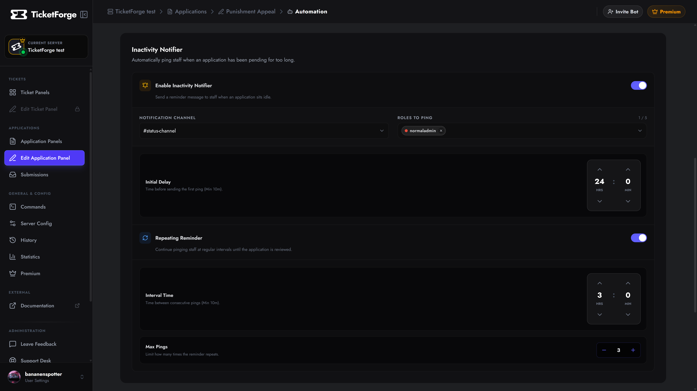
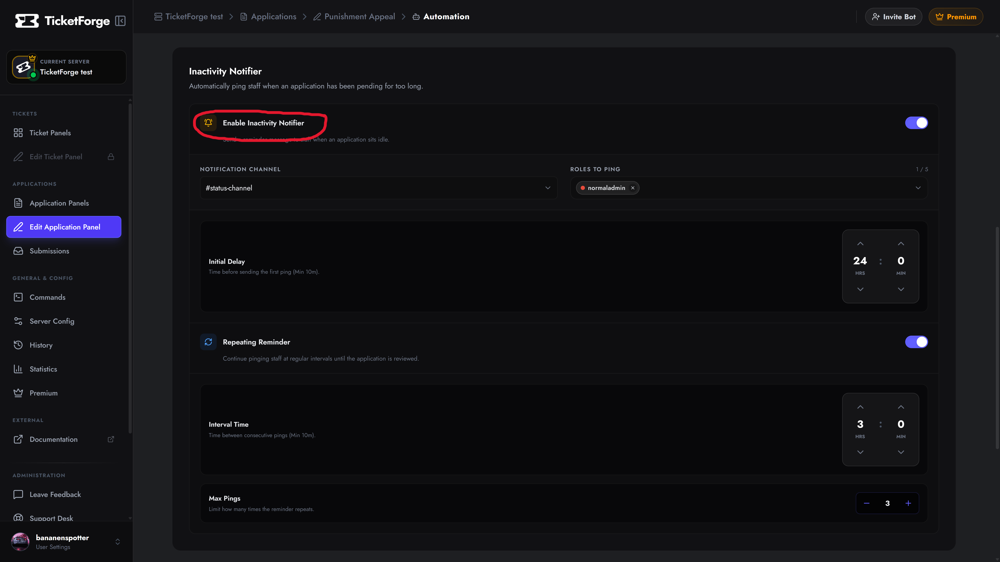
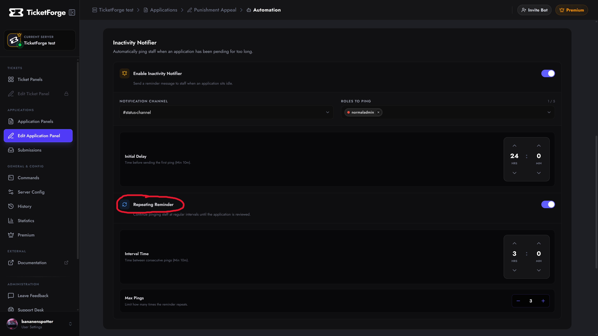

# Inactivity Notifier

*(Premium Feature)*

Never let an application slip through the cracks. The **Inactivity Notifier** acts as a smart alarm clock for your staff. If an application sits in the "Pending" state for too long without being reviewed, the bot will automatically send a reminder ping to your team.

Navigate to **Edit Application > Automation** to configure your notifier settings.

<figure markdown>
  { loading=lazy }
  <figcaption>The notifications configurator on the automation settings page.</figcaption>
</figure>

## 1. Basic Configuration

To enable the notifier, you need to define where the alert goes and who it pings:

1.  **Enable Inactivity Notifier:** Toggle the master switch to ON.
2.  **Notification Channel:** Select the text channel where the reminder ping should be sent. This is usually a private `#staff-chat` or `#management` channel.
3.  **Roles to Ping:** Select the specific Discord roles (e.g., `@Reviewer` or `@Admin`) that should be mentioned in the alert.
4.  **Initial Delay:** The amount of time the application must sit idle before the *first* ping is sent (e.g., 24 hours).

<figure markdown>
  { loading=lazy }
  <figcaption>Set up the channel, roles, and initial delay for your reminders.</figcaption>
</figure>

---

## 2. Repeating Reminders

If your team is busy, a single ping might get lost in the chat. You can enable **Repeating Reminders** to have the bot continuously follow up until a staff member finally clicks Accept or Deny.

*   **Interval Time:** The amount of time the bot should wait between consecutive pings (e.g., every 12 hours).
*   **Max Pings:** Limit how many times the reminder repeats. For example, setting this to `3` means the bot will stop pinging after the 3rd reminder, preventing endless spam if your team is genuinely unavailable.

<figure markdown>
  { loading=lazy }
  <figcaption>Configure the interval and maximum ping limits for repeating alerts.</figcaption>
</figure>

!!! tip "Workflow Synergy"
    The Inactivity Notifier pairs perfectly with the **Auto-Deny Missing Users** feature. If an applicant leaves the server while sitting in the queue, the application is auto-denied, and the Inactivity Notifier is safely canceled so your staff isn't pinged for a dead application!