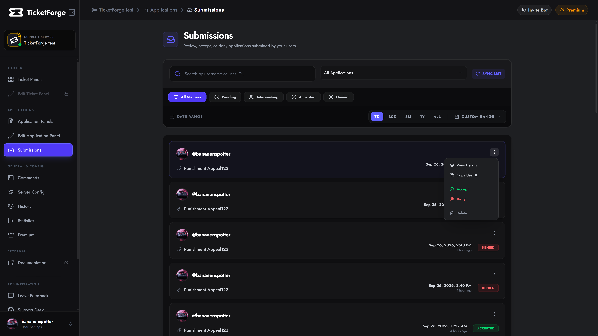
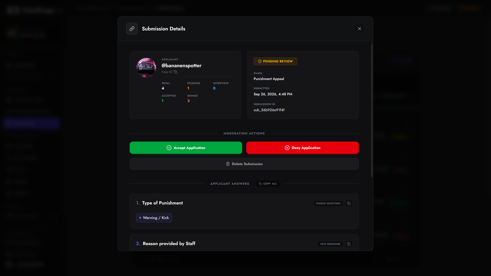
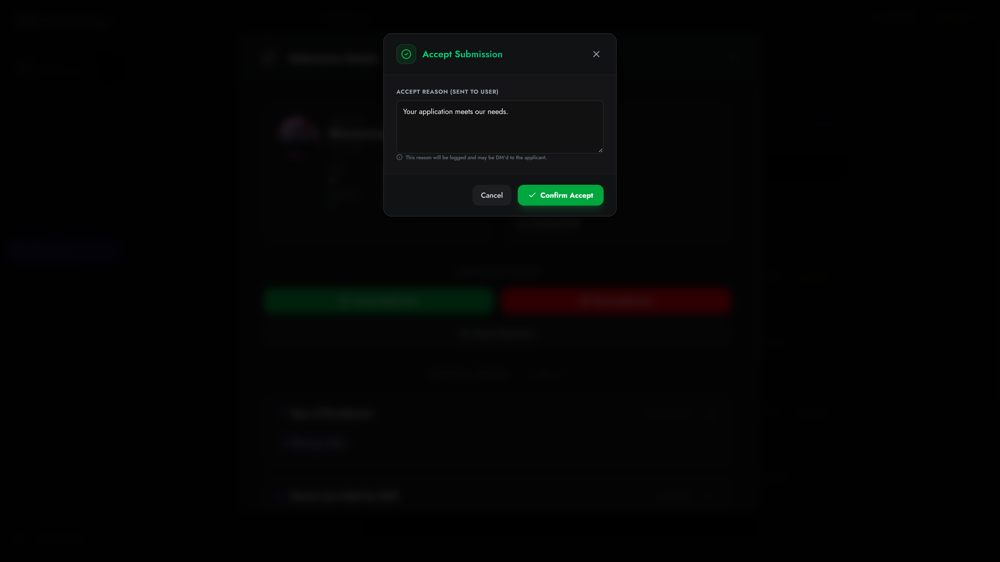

# Processing Submissions

When users complete an application, their answers are sent to two places simultaneously: your **Target Results Channel** in Discord, and your web dashboard.

While you can review applications entirely within Discord using the buttons attached to the application embeds, the **Submissions Dashboard** provides a powerful, unified inbox for your staff to manage high volumes of applicants.

## 1. The Submissions Inbox

Navigate to **Submissions** on the dashboard sidebar to view all applications across your server.

<figure markdown>
  { loading=lazy }
  <figcaption>The Submissions Dashboard allows you to search and filter applications.</figcaption>
</figure>

### Filtering & Searching
Use the top control bar to quickly find what you're looking for:
*   **Search:** Look up a specific user by their Discord Username or User ID.
*   **Panel Filter:** Only show submissions from a specific application (e.g., only show "Builder Applications").
*   **Status Filter:** Filter by lifecycle state:
    *   *Pending:* Awaiting review.
    *   *Interviewing:* Pushed to a secondary stage.
    *   *Accepted / Denied:* Resolved applications.
*   **Date Range:** Filter submissions from the last 7 days, 30 days, or a custom range.

---

## 2. Viewing Application Details

Clicking on any submission card opens the **Details Modal**, giving you complete context before making a decision.

<figure markdown>
  { loading=lazy }
  <figcaption>The Details Modal displays applicant history and their answers.</figcaption>
</figure>

### Applicant Profile & History
At the top of the modal, you'll see the user's avatar, Discord ID, and a historical summary. This helps you identify serial applicants or users who have been repeatedly denied in the past. 
*Displays their Total, Pending, Interviewing, Accepted, and Denied counts.*

### Applicant Answers
Scroll down to view exactly how the user answered your form.
*   **Text Answers:** Displayed in easily readable blocks.
*   **Multiple Choice:** Displayed as clean, tagged pills.
*   **Image Uploads:** Rendered directly in the dashboard so you don't have to open external links to verify proof or portfolios.

---

## 3. Moderation Actions

As a staff member (with a designated Review Role), you can finalize the application using the action buttons.

### Accept or Deny
Clicking **Accept** or **Deny** will open a confirmation prompt requiring a **Reason**. 
*   This reason is logged for your internal records.
*   If you have **Result DMs** configured, this reason is directly messaged to the applicant.
*   Any configured **Role Automation** (e.g., giving them the "Staff" role) triggers instantly upon confirmation.

<figure markdown>
  { loading=lazy }
  <figcaption>Provide a reason when accepting or denying an application.</figcaption>
</figure>

### Delete
Permanently wipes the submission from the database. Use this for spam or test applications. **This action is irreversible.**

### Anonymous Submissions
If your application allows **Anonymous Submissions** (common for feedback forms), the submission will be marked with a special `ANONYMOUS` badge.
Because there is no Discord account attached to the submission, **you cannot Accept or Deny anonymous forms**. They are strictly read-only data for your team.

---

## 4. Discord Integration

You don't *have* to use the web dashboard! TicketForge is deeply integrated into Discord. 

When a user submits an application, the bot posts an embed in your Target Results Channel containing their answers and attached **Staff Action Buttons** (Accept, Deny, Open Interview, User History). 

Your staff can click these buttons directly inside Discord to trigger the exact same moderation modals and automations as the web dashboard.